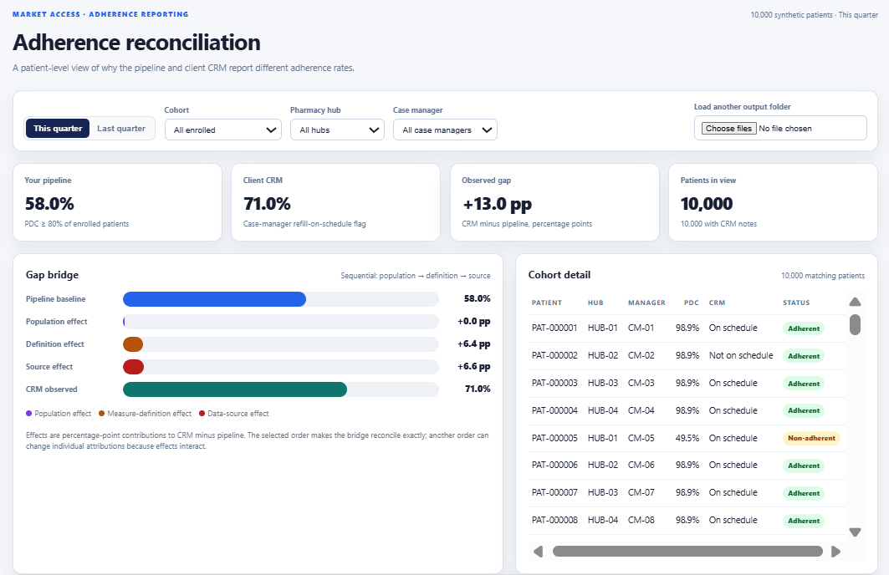
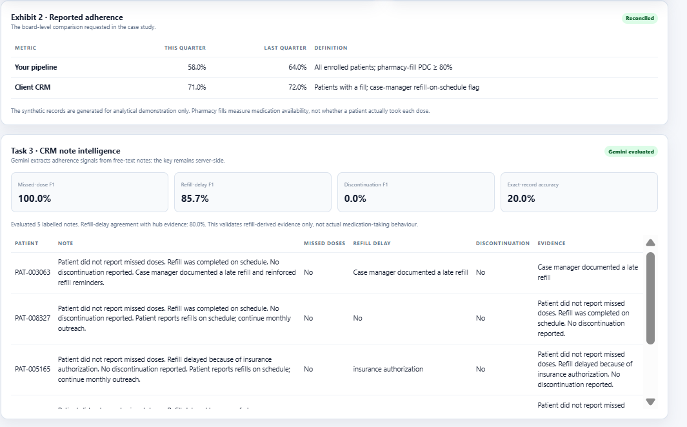

# Synthea adherence dataset

For the design rationale, assumptions, evaluation results, and case-study
answers, see [`SOLUTION.md`](SOLUTION.md). Start with this README for setup and
run instructions.

This project uses [Synthea](https://github.com/synthetichealth/synthea) as the
source of synthetic patient, encounter, and medication history. The generator
then adds specialty-pharmacy hub fills and CRM case-manager notes required for
the adherence-reporting case.

## Generate the records

1. Download a Synthea release from the [Synthea releases page](https://github.com/synthetichealth/synthea/releases)
   and run it with CSV export enabled. Synthea's `output/csv` directory should
   contain at least `patients.csv` and `medications.csv`.
2. Install the Python dependencies:

   ```powershell
   python -m pip install -r requirements.txt
   ```

3. Generate the patient-level and normalized datasets from Synthea:

   ```powershell
   python .\generate_synthetic_patient_data.py `
     --synthea-dir .\synthea\output\csv `
     --output-dir .\data\generated
   ```

For the complete case-study demo, generate exactly 10,000 reproducible
Synthea-shaped patients (this path does not require Java and keeps the same
source-compatible schema):

```powershell
python .\generate_synthetic_patient_data.py `
  --demo-patients 10000 `
  --output-dir .\data\generated
```

The output includes:

- `patient_records.csv`: one row per patient, including enrollment, medication
  starts/refills, supply days, hub records, CRM notes, adherence, missed doses,
  delays, and discontinuation reasons.
- `pharmacy_hub_fills.csv`: one row per specialty-pharmacy fill.
- `crm_case_manager_notes.csv`: one row per quarterly CRM assessment.
- `exhibit_2_metrics.csv`: the requested aggregate figures: pipeline 58% this
  quarter / 64% last quarter and CRM 71% / 72%.

The Synthea identifiers are retained only as source lineage. All generated
patient IDs use the `PAT-######` format, and all added pharmacy/CRM events are
deterministic for reproducibility.

## Calculate the metrics and gap bridge

After generating the records, run:

```powershell
python .\analyze_adherence_gap.py `
  --input-dir .\data\generated `
  --output-dir .\data\generated
```

This writes `adherence_gap_bridge.csv` and `adherence_gap_bridge.md`. The
bridge uses a sequential decomposition in the order **population -> measure
definition -> data source**:

1. Start with all enrolled patients and hub-fill PDC >= 80% (pipeline).
2. Restrict to the CRM population defined by the case study: patients with at
   least one specialty-pharmacy fill.
3. Replace PDC with a hub-derived on-time refill flag.
4. Replace the hub flag with the CRM case-manager flag (CRM). Patients in the
   fill population without a CRM note remain in the denominator and are
   treated as not on schedule for this operational metric; they are not
   silently removed.

The three percentage-point effects sum to the observed CRM-minus-pipeline gap.
This order is stated explicitly because interaction effects mean that changing
the order changes the individual attribution, even though the total bridge is
unchanged.

## Extract structured signals from CRM notes

The generator labels each synthetic note, including missed doses, missed
duration, refill delay, reasons, and discontinuation. To evaluate Gemini on a
labelled sample, set the API key locally and run:

```powershell
# .env is loaded automatically by extract_note_signals.py
python .\extract_note_signals.py `
  --input-dir .\data\generated `
  --output-dir .\data\generated `
  --sample-size 50
```

The script writes note-level predictions plus precision, recall, F1, binary
agreement, reason accuracy, and exact-record extraction accuracy. It also
reports agreement between the extracted refill-delay signal and delayed hub
fills. That comparison is explicitly labelled as **refill-derived evidence**:
pharmacy timing cannot prove that a patient actually swallowed a dose, so it is
not treated as ground truth for missed-dose behaviour.

The reconciliation website automatically loads these optional outputs when they
exist and displays Task 3 F1 scores, exact-record accuracy, refill-evidence
agreement, and a note-level evidence table. The Gemini key is never loaded by
the browser. If Gemini returns HTTP 429, the extractor writes
`note_extraction_status.json`; the website displays **Limit reached** and the
provider's retry/reset time in the Task 3 panel.

To evaluate more notes from the website in controlled 15-note batches, start
the local dashboard server:

```powershell
python .\dashboard_server.py
```

Then click **Evaluate next 15** in the Task 3 panel. Each click sends at most
15 notes through Gemini, appends the results, recomputes metrics, and refreshes
the table. This avoids claiming that five notes represent the full dataset and
respects the provider's request-per-minute quota. The button also surfaces the
provider's retry/reset time when a quota response occurs.

## Open the reconciliation view

`reconciliation_view.html` is a dependency-free browser dashboard with:

- This-quarter / last-quarter toggle
- Cohort, pharmacy hub, and case-manager filters
- Pipeline, CRM, gap, and population KPIs
- Sequential population / definition / source gap bridge
- Patient-level cohort table

Generate the CSVs first, then serve the project directory locally:

```powershell
python -m http.server 8000
```

Open `http://localhost:8000/reconciliation_view.html`. The dashboard normally
reads data from `data/generated/`. **Load another output folder** lets you
preview a different generated dataset in the current browser session without
copying, moving, or overwriting project files. Select a folder containing
`patient_records.csv`, `pharmacy_hub_fills.csv`, and
`crm_case_manager_notes.csv`; the dashboard then recalculates its filters,
KPIs, cohort table, and gap bridge from those selected files. Optional Gemini
result files are still loaded from `data/generated/`.

The site includes the complete Exhibit 2 comparison:

| Metric | This quarter | Last quarter |
|---|---:|---:|
| Your pipeline | 58% | 64% |
| Client CRM | 71% | 72% |

The displayed Exhibit 2 values are fixed board-level targets; filters update
the patient-level reconciliation view and gap bridge below them.

## Dashboard screenshots

### Reconciliation overview



### Exhibit 2 and Task 3 note intelligence


